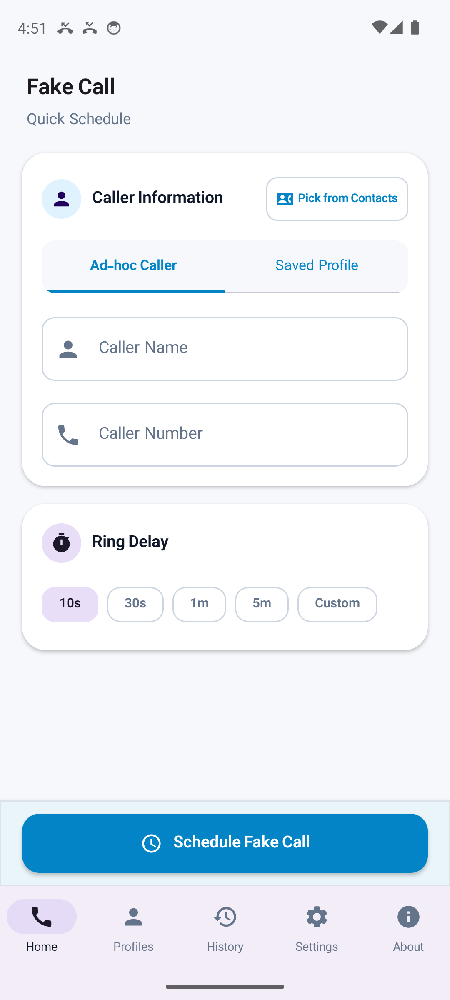
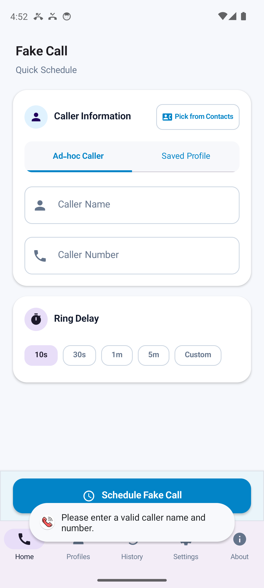
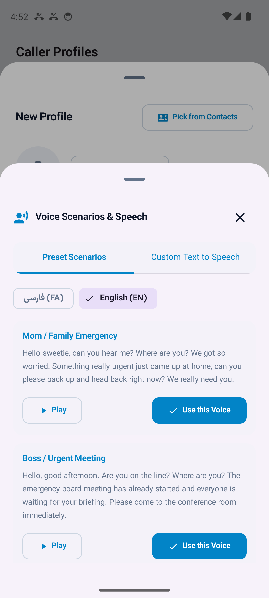
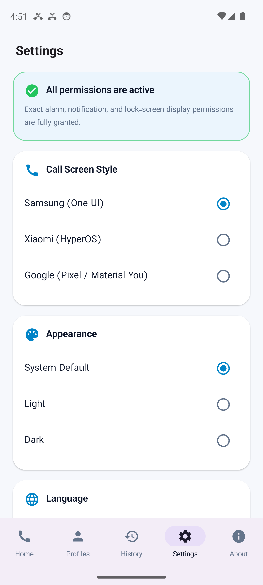
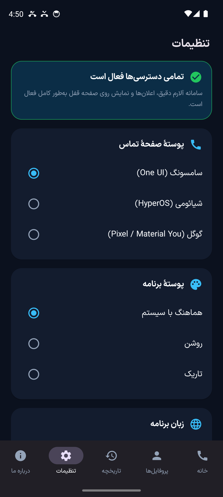

# Fake Call

[فارسی](README.md) · **English**

A modern and realistic native Android application designed to schedule genuine-looking incoming fake calls with customized caller ID, phone number, and avatar photo. A polite and effortless escape strategy for tedious meetings, uncomfortable gatherings, or unwanted situations. 100% offline, zero internet access, zero tracking.

`v1.0.0` · Android 8.0+ (API 26) · MIT License

<p align="center">
  <a href="https://github.com/mostafaafrouzi/fake-call-android/releases/latest">
    
  </a>
  &nbsp;&nbsp;
  <a href="https://cafebazaar.ir/app/com.afrouzi.fakecall">
    
  </a>
  &nbsp;&nbsp;
  <a href="https://myket.ir/app/com.afrouzi.fakecall">
    
  </a>
</p>

---

## Key Features

### 1. Ultra-Realistic Incoming Call Experience
- **Multiple Call Screen Themes:** Authentic replications of Samsung (**One UI**), Xiaomi (**HyperOS**), and Google (**Pixel / Material You**) in-call UIs.
- **Natural Touch Gestures:** Authentic swipe-to-answer or swipe-to-decline controls, default phone ringtones, and realistic vibration patterns.
- **Interactive Active Call Screen:** Live call duration timer, functional mute, speaker toggle, and working in-call dialpad (keypad).

### 2. Studio-Grade AI Voice Scenarios (Powered by Gemini AI)
- **Automatic Audio Playback on Answer:** When you pick up the phone, a lifelike conversation audio plays directly into the earpiece/speaker to convince anyone nearby.
- **Natural 2-Second Answering Pause:** Every scenario starts with a greeting, followed by 2 seconds of pure silence, allowing you to realistically reply ("Hello? Yes, speaking...") before the caller continues.
- **8 Pre-Recorded Scenarios (Persian & English):**
  - **Mom / Family Emergency:** Caring, urgent, colloquial family tone.
  - **Boss / Urgent Meeting:** Formal, authoritative corporate emergency.
  - **Close Friend / Hangout:** Casual buddy voice wondering where you are.
  - **Office / Administrative Inquiry:** Crisp administrative official matter.
- **Custom Voice Recording:** Record your own audio or friends' voices via built-in microphone and attach it to any profile.

### 3. Discreet Gestures & Sensors
- **Shake to Call:** Secretly shake your phone in your pocket to trigger a scheduled fake call without ever touching the screen.
- **Proximity Sensor:** Automatically turns off the screen when you hold the device to your ear during the call, mimicking authentic phone hardware behavior.

### 4. Fast Access & Widgets
- **Home Screen App Widget:** Launch a pre-configured fake call directly with a single tap from your launcher.
- **Quick Settings Tile:** Add an "Emergency Call" button to your Android notification quick settings shade.
- **Contact Picker Integration:** Auto-import caller name, phone number, and avatar image directly from your Android address book.

---

## Screenshots

<p align="center">
  
  &nbsp;&nbsp;
  
  &nbsp;&nbsp;
  
</p>

<p align="center">
  
  &nbsp;&nbsp;
  
  &nbsp;&nbsp;
  
</p>

---

## Privacy & Security

Fake Call is built with strict privacy-by-design standards:
- **Zero Internet Access:** The `android.permission.INTERNET` permission is completely absent from `AndroidManifest.xml`. It is technically impossible for any data, photo, or audio to leave your device.
- **No Ads, No Trackers:** Zero third-party analytics SDKs, tracking libraries, or advertising frameworks.
- **100% On-Device Storage:** All custom profiles, contact avatars, and voice recordings remain exclusively in private app-internal sandbox storage.

### Declared Permissions

| Permission | Purpose | Requested When |
| :--- | :--- | :--- |
| `POST_NOTIFICATIONS` | Post foreground in-call and missed call notifications | First scheduled call |
| `SCHEDULE_EXACT_ALARM` | Ring at the exact second scheduled even in Doze mode | System prompt on launch |
| `USE_FULL_SCREEN_INTENT` | Display full-screen call UI over lock screen | System level |
| `READ_CONTACTS` | Autofill caller name, phone number & avatar from contacts | Optional, only when tapping "Pick from contacts" |
| `RECORD_AUDIO` | Record custom voice scenario via microphone | Optional, only when recording voice |
| `VIBRATE` | Device vibration during incoming ring | Default |
| `RECEIVE_BOOT_COMPLETED` | Restore shake listener service after phone reboot | Boot time |
| `FOREGROUND_SERVICE` | Monitor accelerometer for the Shake to Call gesture | Background service |

---

## For Developers

### Tech Stack
- **Language:** Kotlin
- **UI Framework:** Jetpack Compose with Material 3 components
- **Architecture:** MVVM + Clean Architecture with Coroutines and Flow
- **Persistence:** Room Database & Jetpack DataStore Preferences
- **Scheduling:** Exact AlarmManager with Full-Screen Intent and Foreground Services
- **Hardware Integration:** SensorManager (Accelerometer & Proximity), MediaPlayer

| Specification | Value |
| :--- | :--- |
| Package Name | `com.afrouzi.fakecall` |
| minSdk / targetSdk / compileSdk | 26 / 35 / 35 |
| Kotlin / Compose Compiler | 2.0.21 / 1.5.15 |
| versionName / versionCode | 1.0.0 / 1 |

### Source Tree
```
app/src/main/java/com/afrouzi/fakecall/
├── call/              Incoming & active call activities and audio playback
├── data/
│   ├── db/            Room database entities and DAOs
│   ├── model/         Data models (Profile, CallHistory, VoiceScenario)
│   ├── prefs/         DataStore preferences repository
│   └── repository/    Media file managers, contact pickers, voice managers
├── scheduling/        Exact alarms, boot receiver, shake sensor foreground service
├── ui/                Compose screens (Home, Profiles, Settings, History, Themes)
└── widget/            Home screen app widget and Quick Settings TileService
```

### Building Locally
```bash
git clone https://github.com/mostafaafrouzi/fake-call-android.git
cd fake-call-android
./gradlew assembleDebug
```

To build signed release artifacts:
```bash
./gradlew assembleBazaarRelease assembleMyketRelease
```

---

## Release History

### 1.0.0 (Initial Public Release)
- Modern Material 3 UI overhaul optimized for high-resolution flagship displays.
- 8 studio-quality AI voice scenarios powered by Gemini TTS with realistic 2-second answering pause.
- Realistic call skins: Samsung One UI, Xiaomi HyperOS, and Google Pixel.
- Discreet Shake-to-Call motion gesture detection.
- Proximity sensor support for authentic ear-to-phone screen blanking.
- Address book contact import with automated photo, name, and phone extraction.
- Interactive in-call dialpad and active timer.
- Quick Settings tile and Home Screen widget.
- Full bilingual English and Persian support with Dark/Light themes.

---

## Developer

**Mostafa Afrouzi**
- Website: [afrouzi.ir](https://afrouzi.ir/?utm_source=fakecall&utm_medium=github_readme&utm_campaign=fakecall)
- GitHub: [github.com/mostafaafrouzi](https://github.com/mostafaafrouzi)
- LinkedIn: [linkedin.com/in/mostafaafrouzi](https://linkedin.com/in/mostafaafrouzi)
- Cafe Bazaar Developer: [cafebazaar.ir/developer/057657612999](https://cafebazaar.ir/developer/057657612999)
- Myket Developer: [myket.ir/developer/dev-102174](https://myket.ir/developer/dev-102174)

## License

Open-source and licensed under the [MIT License](LICENSE). Iranian typography provided by IRANSansX font family.
