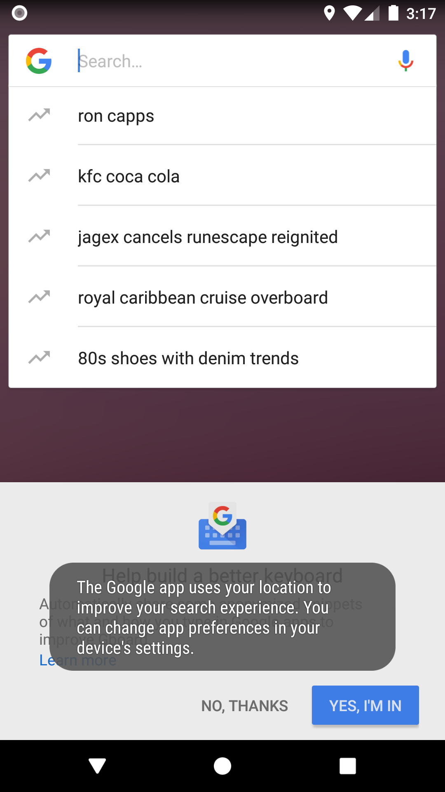
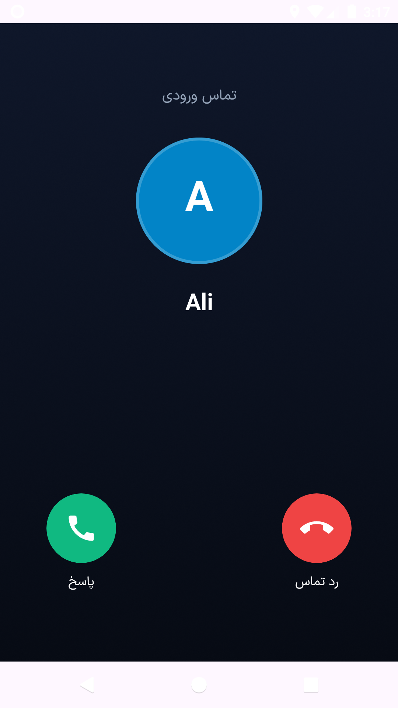
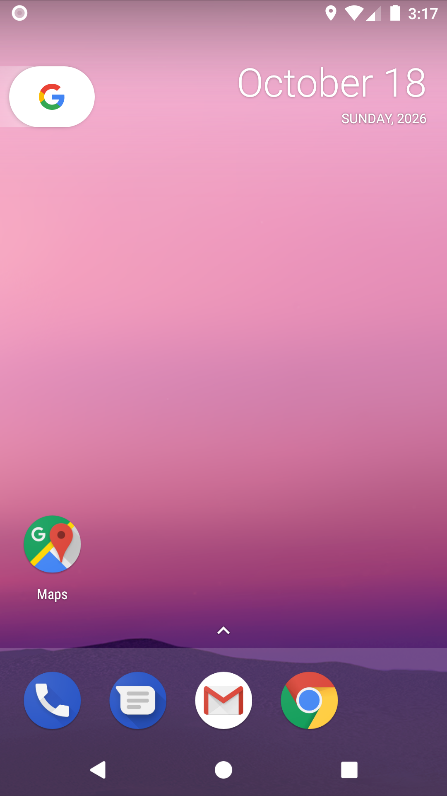
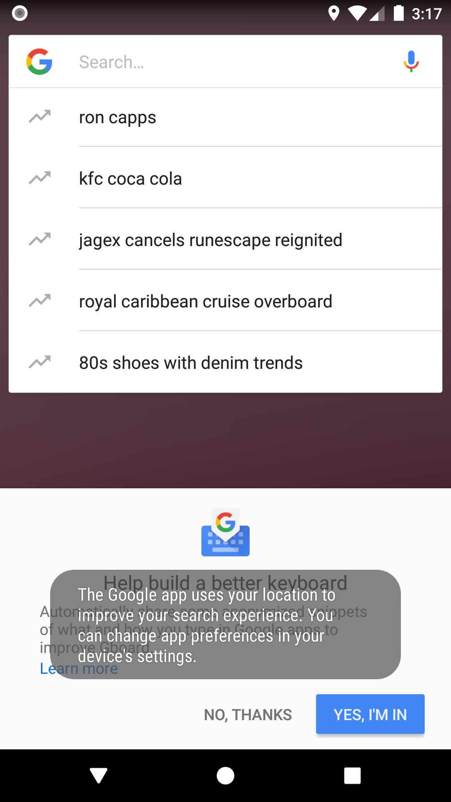
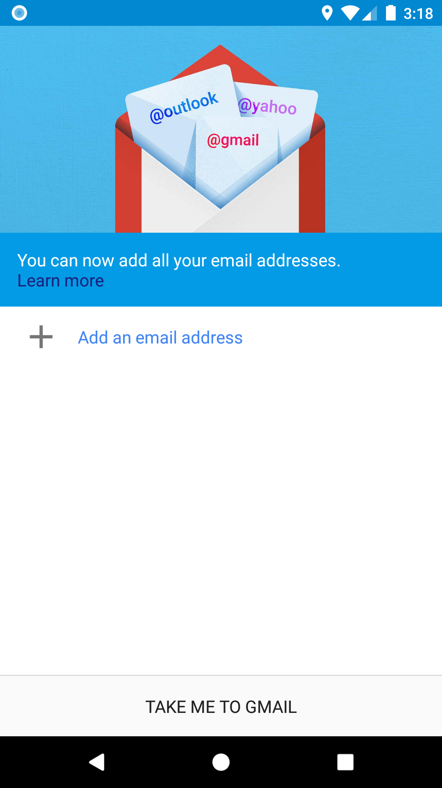
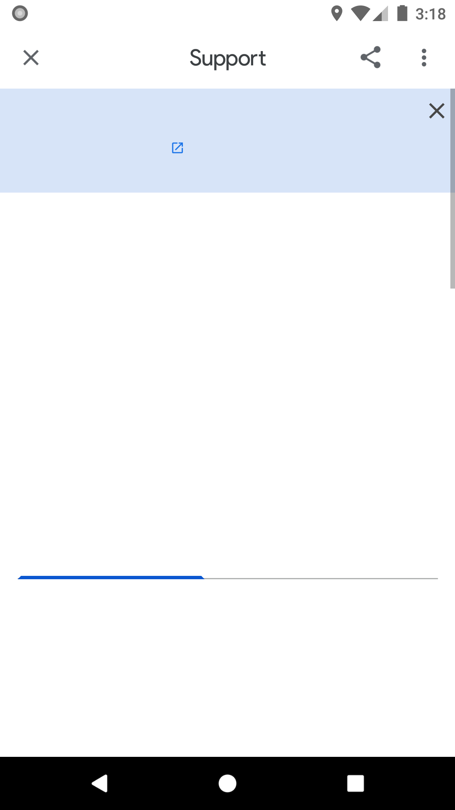

# تماس ساختگی

**فارسی** · [English](README.en.md)

برنامهٔ اندروید برای زمان‌بندی یک تماس ورودی ساختگی با نام، شماره و عکس دلخواه شما؛ دقیقاً در زمانی که لازم دارید زنگ می‌خورد تا بتوانید مؤدبانه از جلسه، قرار یا هر موقعیت ناخوشایندی خارج شوید.

<div dir="ltr">

`نسخهٔ ۰.۱.۰-beta1 (بتا)` · اندروید ۸ (API 26) و بالاتر · MIT

</div>

---

## چه کاری انجام می‌دهد

- **پروفایل تماس‌گیرنده بسازید:** نام، شماره، عکس و حتی صدای ضبط‌شده برای هر تماس‌گیرنده ذخیره کنید؛ مثلاً «رئیس»، «مامان» یا «همکارم».
- **زمان‌بندی دقیق:** تماس را برای ۱۰ ثانیه، ۳۰ ثانیه، ۱ دقیقه، ۵ دقیقهٔ دیگر یا هر زمان دلخواه تنظیم کنید. با آلارم دقیق اندروید، تماس سر وقت زنگ می‌خورد؛ حتی اگر برنامه بسته باشد یا گوشی قفل باشد.
- **تماس واقع‌گرایانه:** صفحهٔ تماس ورودی تمام‌صفحه با عکس و نام تماس‌گیرنده، رینگتون و ویبره؛ بعد از پاسخ‌دادن، صدای ضبط‌شدهٔ همان پروفایل پخش می‌شود تا همه‌چیز طبیعی به نظر برسد.
- **تاریخچه:** همهٔ تماس‌های ساختگی اجراشده داخل برنامه ثبت می‌شوند.
- **کاملاً آفلاین و خصوصی:** بدون اینترنت، بدون حساب کاربری، بدون ردیابی و بدون تبلیغ.

## ویژگی‌ها

- دوزبانه (فارسی و انگلیسی) با تشخیص خودکار زبان سیستم و امکان تغییر دستی در تنظیمات
- تم روشن و تاریک هماهنگ با سیستم
- پشتیبانی کامل از چیدمان راست‌چین
- پروفایل‌های نامحدود با عکس و صدای اختصاصی
- شمارش معکوس زنده برای تماس زمان‌بندی‌شده و امکان لغو

## تصاویر

<p align="center">
  
  
  
  
</p>

<p align="center">
  
  
  
</p>

## پشتهٔ فناوری

| بخش | فناوری |
| --- | --- |
| زبان | Kotlin |
| رابط کاربری | Jetpack Compose · Material 3 |
| معماری | MVVM · Clean Architecture |
| ذخیره‌سازی | Room · DataStore |
| زمان‌بندی | AlarmManager (Exact Alarm) · Full-Screen Intent |
| حداقل اندروید | API 26 (اندروید ۸) |
| هدف | API 35 (اندروید ۱۵) |

## بیلد محلی

```bash
git clone https://github.com/mostafaafrouzi/fake-call-android.git
cd fake-call-android
./gradlew assembleDebug
```

برای بیلد ریلیز امضاشده، فایل `keystore.properties` را در ریشهٔ پروژه قرار دهید (الگو در مستندات چارچوب پروژه). نسخه‌های بازار و مایکت فقط در لینک صفحهٔ توسعه‌دهندهٔ داخل برنامه تفاوت دارند:

```bash
./gradlew assembleBazaarRelease assembleMyketRelease
```

## دریافت

- [ریلیزهای گیت‌هاب](https://github.com/mostafaafrouzi/fake-call-android/releases)
- صفحهٔ توسعه‌دهنده در کافه‌بازار و مایکت (پس از انتشار در مارکت‌ها لینک مستقیم برنامه اضافه می‌شود)

## ارتباط با توسعه‌دهنده

- وب‌سایت: [afrouzi.ir](https://afrouzi.ir/?utm_source=fakecall&utm_medium=github_readme&utm_campaign=fakecall)
- لینکدین: [linkedin.com/in/mostafaafrouzi](https://linkedin.com/in/mostafaafrouzi)
- گیت‌هاب: [github.com/mostafaafrouzi](https://github.com/mostafaafrouzi)

## مجوز

این پروژه متن‌باز و تحت مجوز MIT منتشر می‌شود.
