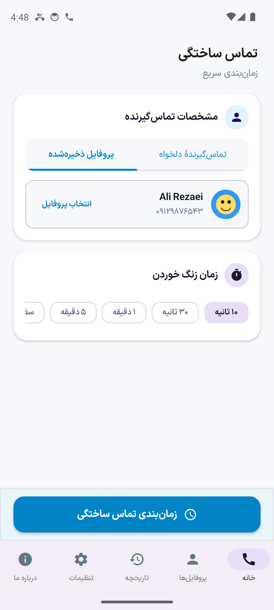
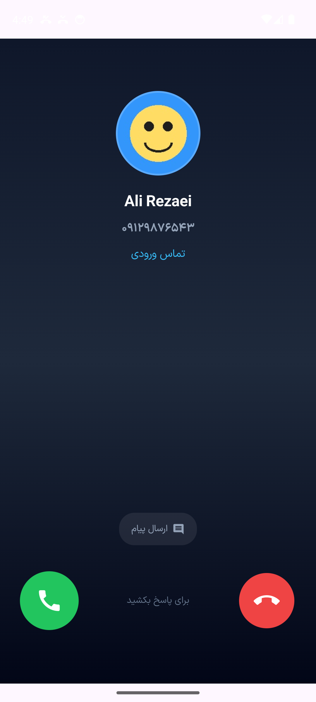
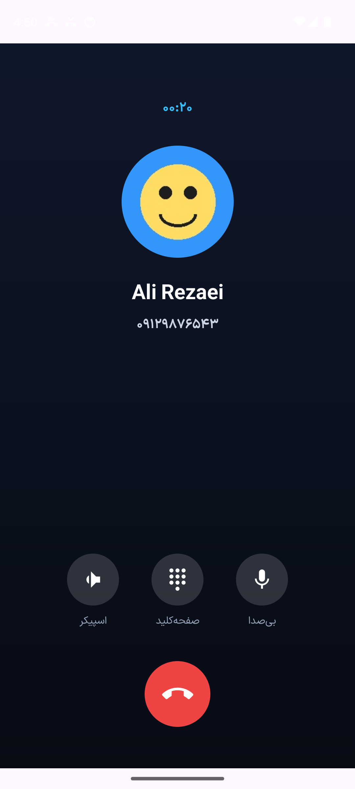
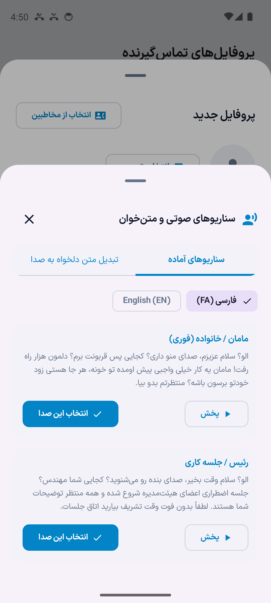
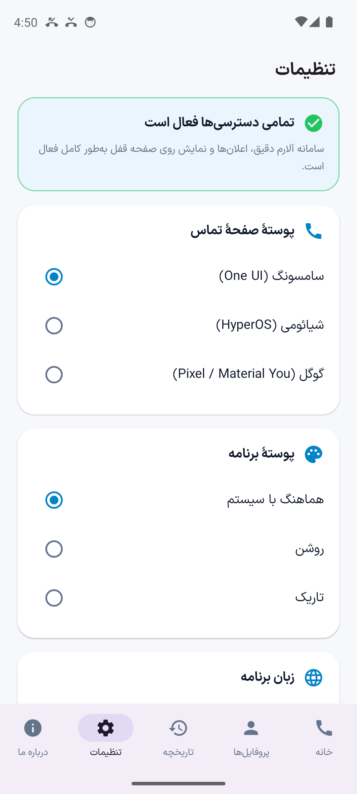
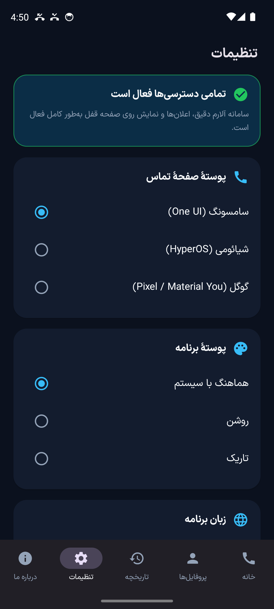

# تماس ساختگی (Fake Call)

**فارسی** · [English](README.en.md)

برنامهٔ بومی و مدرن اندروید برای زمان‌بندی یک تماس ورودی کاملاً واقع‌گرایانه با نام، شماره و تصویر دلخواه؛ راهی مؤدبانه و طبیعی برای خروج از جلسات کاری فرسایشی، قرارهای ناخوشایند یا هر موقعیت معذب‌کننده دیگر. همه‌چیز ۱۰۰٪ آفلاین، بدون نیاز به اینترنت و بدون ردیابی روی گوشی خودتان اجرا می‌شود.

<div dir="ltr">

`نسخهٔ ۱.۰.۰` · اندروید ۸ (API 26) و بالاتر · مجوز MIT

</div>

<p align="center">
  <a href="https://cafebazaar.ir/app/com.afrouzi.fakecall">
    
  </a>
  &nbsp;&nbsp;
  <a href="https://myket.ir/app/com.afrouzi.fakecall">
    
  </a>
  &nbsp;&nbsp;
  <a href="https://github.com/mostafaafrouzi/fake-call-android/releases/latest">
    
  </a>
</p>

---

## قابلیت‌های کلیدی

### ۱. تماس ورودی کاملاً واقع‌گرایانه
- **پوسته‌های متنوع صفحهٔ تماس:** پشتیبانی از طراحی رسمی تماس ورودی سامسونگ (**One UI**)، شیائومی (**HyperOS**) و گوگل (**Pixel / Material You**).
- **انیمیشن و تعامل لمسی طبیعی:** کشیدن دکمه برای پاسخ‌گویی یا رد تماس، ویبره و صدای زنگ پیش‌فرض دستگاه.
- **صفحهٔ حین مکالمه تعاملی:** نمایش شمارشگر زمان مکالمه با ارقام فارسی، دکمه‌های قطع صدا (Mute)، اسپیکر و صفحه‌کلید شماره‌گیر (Keypad) فعال.

### ۲. سناریوهای صوتی هوشمند (تولیدشده با Gemini AI)
- **پخش صدای واقعی هنگام پاسخ:** هنگام برداشتن گوشی، فایل صوتی همان سناریو پخش می‌شود تا طرف مقابل یا افراد حاضر در جمع صدای یک تماس واقعی را بشنوند.
- **وقفهٔ طبیعی ۲ ثانیه‌ای برای پاسخ:** در تمامی صداها، ۲ ثانیه سکوت بین احوالپرسی ابتدایی («الو؟ سلام...») و بدنهٔ مکالمه قرار گرفته تا بتوانید به سلام تماس‌گیرنده جواب دهید و سناریو ۱۰۰٪ طبیعی اجرا شود.
- **۸ سناریوی آمادهٔ استودیویی (فارسی و انگلیسی):**
  - **مامان / خانواده (فوری):** لحن خودمانی، مادری و نگران
  - **رئیس / جلسه کاری:** لحن رسمی، جدی و شرکتی
  - **دوست صمیمی / قرار:** لحن رفاقتی و کژوال
  - **اداری و پیگیری کاری:** لحن رسمی، دقیق و اداری
- **ضبط صدای دلخواه با میکروفون:** امکان ضبط صدای دوستان یا خودتان با فرمت فشرده و استفاده به عنوان صدای تماس‌گیرنده.

### ۳. ژست‌های حرکتی و سنسورها
- **تماس با تکان دادن گوشی (Shake to Call):** بدون دست زدن به صفحه و با چند تکان محرمانه گوشی در جیب، تماس ساختگی زمان‌بندی و زنگ می‌خورد.
- **سنسور مجاورت (Proximity Sensor):** هنگام نزدیک کردن گوشی به گوش در حین مکالمه، صفحه به صورت خودکار خاموش می‌شود تا رفتاری شبیه به تماس واقعی تلفن همراه داشته باشد.

### ۴. دسترسی سریع و ویجت
- **ویجت اختصاصی صفحهٔ اصلی (App Widget):** امکان راه‌اندازی تماس با یک لمس مستقیم از روی هوم‌اسکرین.
- **کاشی تنظیمات سریع (Quick Settings Tile):** دکمهٔ «تماس اضطراری» در پنل بالای نوتیفیکیشن‌های اندروید برای اجرای سریع تماس ۲۰ ثانیه بعد.
- **انتخاب مستقیم از مخاطبین:** امکان خواندن مستقیم نام، شماره و عکس پروفایل از مخاطبین دفترچه تلفن گوشی.

---

## تصاویر برنامه

<p align="center">
  
  &nbsp;&nbsp;
  
  &nbsp;&nbsp;
  
</p>

<p align="center">
  
  &nbsp;&nbsp;
  
  &nbsp;&nbsp;
  
</p>

---

## حریم خصوصی و امنیت

این برنامه با پایبندی سخت‌گیرانه به حریم خصوصی ساخته شده است:
- **عدم وجود مجوز اینترنت:** مجوز `android.permission.INTERNET` در مانیفست برنامه وجود ندارد. از نظر فنی هیچ داده‌ای، تصویری یا صدایی امکان خروج از گوشی شما را ندارد.
- **بدون تبلیغات و بدون ردیاب:** هیچ SDK آماری، تبلیغاتی یا تحلیلی در برنامه استفاده نشده است.
- **ذخیره‌سازی کاملاً محلی:** کلیه پروفایل‌ها و فایل‌های صوتی فقط در فضای محلی و خصوصی برنامه ذخیره می‌شوند.

### مجوزهای مورد استفاده

| مجوز | هدف استفاده | زمان درخواست |
| :--- | :--- | :--- |
| `POST_NOTIFICATIONS` | نمایش اعلان تماس ورودی در پس‌زمینه | هنگام اولین زمان‌بندی تماس |
| `SCHEDULE_EXACT_ALARM` | زنگ خوردن تماس در ثانیهٔ دقیق تنظیم‌شده | از طریق تنظیمات سیستم |
| `USE_FULL_SCREEN_INTENT` | نمایش صفحهٔ تماس تمام‌صفحه حتی در زمان قفل بودن گوشی | دسترسی سیستمی |
| `READ_CONTACTS` | انتخاب نام، شماره و تصویر مخاطب از دفترچه تلفن | اختیاری، فقط با زدن دکمه انتخاب از مخاطبین |
| `RECORD_AUDIO` | ضبط صدای دلخواه برای پخش حین مکالمه | اختیاری، فقط با زدن دکمه ضبط صدا |
| `VIBRATE` | ویبره رفتن گوشی هنگام زنگ تماس ورودی | پیش‌فرض |
| `RECEIVE_BOOT_COMPLETED` | برقراری مجدد سرویس تکان دادن گوشی بعد از ریستارت | پیش‌فرض سیستم |
| `FOREGROUND_SERVICE` | پایش سنسور شتاب‌سنج برای قابلیت Shake to Call | پیش‌فرض سیستم |

---

## برای توسعه‌دهندگان

### فناوری‌های استفاده‌شده
- **زبان:** Kotlin
- **رابط کاربری:** Jetpack Compose با کامپوننت‌های مدرن Material 3
- **معماری:** MVVM + Clean Architecture با کاتلین Coroutines و Flow
- **پایگاه‌داده و ذخیره‌سازی:** Room Database و Jetpack DataStore Preferences
- **زمان‌بندی:** Exact AlarmManager با Full-Screen Intent و Foreground Services
- **صدا و سنسورها:** MediaPlayer ،SensorManager (Accelerometer & Proximity)

<div dir="ltr">

| مشخصه | مقدار |
| :--- | :--- |
| Package Name | `com.afrouzi.fakecall` |
| minSdk / targetSdk / compileSdk | 26 / 35 / 35 |
| Kotlin / Compose Compiler | 2.0.21 / 1.5.15 |
| versionName / versionCode | 1.0.0 / 1 |

</div>

### ساختار پوشه‌های سورس‌کد
```
app/src/main/java/com/afrouzi/fakecall/
├── call/              مدیریت و فعالیت صفحهٔ تماس ورودی و حین مکالمه
├── data/
│   ├── db/            دیتابیس Room، جداول تماس‌ها و پروفایل‌ها
│   ├── model/         مدل‌های داده‌ای (Profile, CallHistory, VoiceScenario)
│   ├── prefs/         تنظیمات برنامه بر بستر DataStore
│   └── repository/    مدیریت فایل‌های صوتی، تصاویر و مخاطبان
├── scheduling/        آلارم دقیق، گیرنده رویدادهای سیستم، سرویس سنسور شتاب‌سنج
├── ui/                صفحات کامپوز (Home, Profiles, Settings, History, About, Themes)
└── widget/            ویجت هوم‌اسکرین و کاشی تنظیمات سریع (TileService)
```

### ساخت نسخهٔ محلی (Build)
```bash
git clone https://github.com/mostafaafrouzi/fake-call-android.git
cd fake-call-android
./gradlew assembleDebug
```

برای ساخت نسخهٔ رسمی مخصوص کافه‌بازار یا مایکت:
```bash
./gradlew assembleBazaarRelease assembleMyketRelease
```

---

## تاریخچه نسخه‌ها

### ۱.۰.۰ (انتشار عمومی نخستین)
- بازطراحی کامل رابط کاربری با الهام از متریال ۳ و استانداردهای نمایشگرهای پرچمدار مدرن
- اضافه شدن ۸ سناریوی صوتی هوشمند تولیدشده با Gemini AI با وقفهٔ طبیعی ۲ ثانیه‌ای پاسخگویی
- اضافه شدن پوسته تماس‌های One UI سامسونگ، HyperOS شیائومی و Material You گوگل
- قابلیت تماس با تکان دادن گوشی (Shake to Call) با حساسیت بهینه
- سنسور مجاورت و خاموش‌شدن هوشمند صفحه حین مکالمه
- انتخاب مخاطب از دفترچه تلفن به همراه دریافت خودکار عکس، نام و شماره
- ویجت اختصاصی صفحه اصلی و Quick Settings Tile
- پشتیبانی کامل از دو زبان فارسی و انگلیسی با تم‌های تاریک و روشن

---

## توسعه‌دهنده

**مصطفی افروزی**
- وب‌سایت: [afrouzi.ir](https://afrouzi.ir/?utm_source=fakecall&utm_medium=github_readme&utm_campaign=fakecall)
- گیت‌هاب: [github.com/mostafaafrouzi](https://github.com/mostafaafrouzi)
- لینکدین: [linkedin.com/in/mostafaafrouzi](https://linkedin.com/in/mostafaafrouzi)
- برنامه‌های دیگر در کافه‌بازار: [cafebazaar.ir/developer/057657612999](https://cafebazaar.ir/developer/057657612999)
- برنامه‌های دیگر در مایکت: [myket.ir/developer/dev-102174](https://myket.ir/developer/dev-102174)

## مجوز (License)

این پروژه متن‌باز و تحت مجوز [MIT](LICENSE) منتشر شده است. فونت‌های استفاده شده متعلق به خانواده ایران‌سنس‌اکس هستند.
